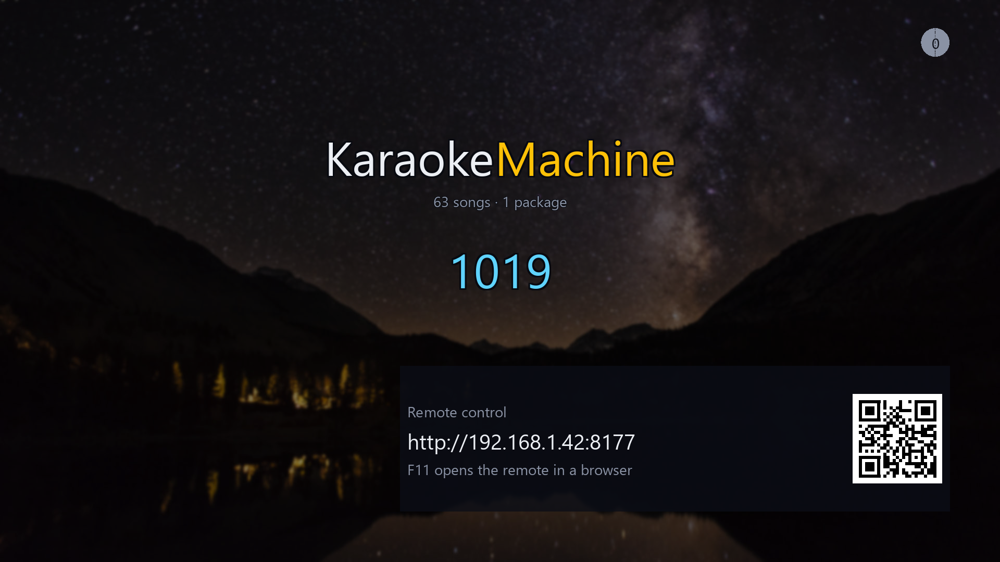
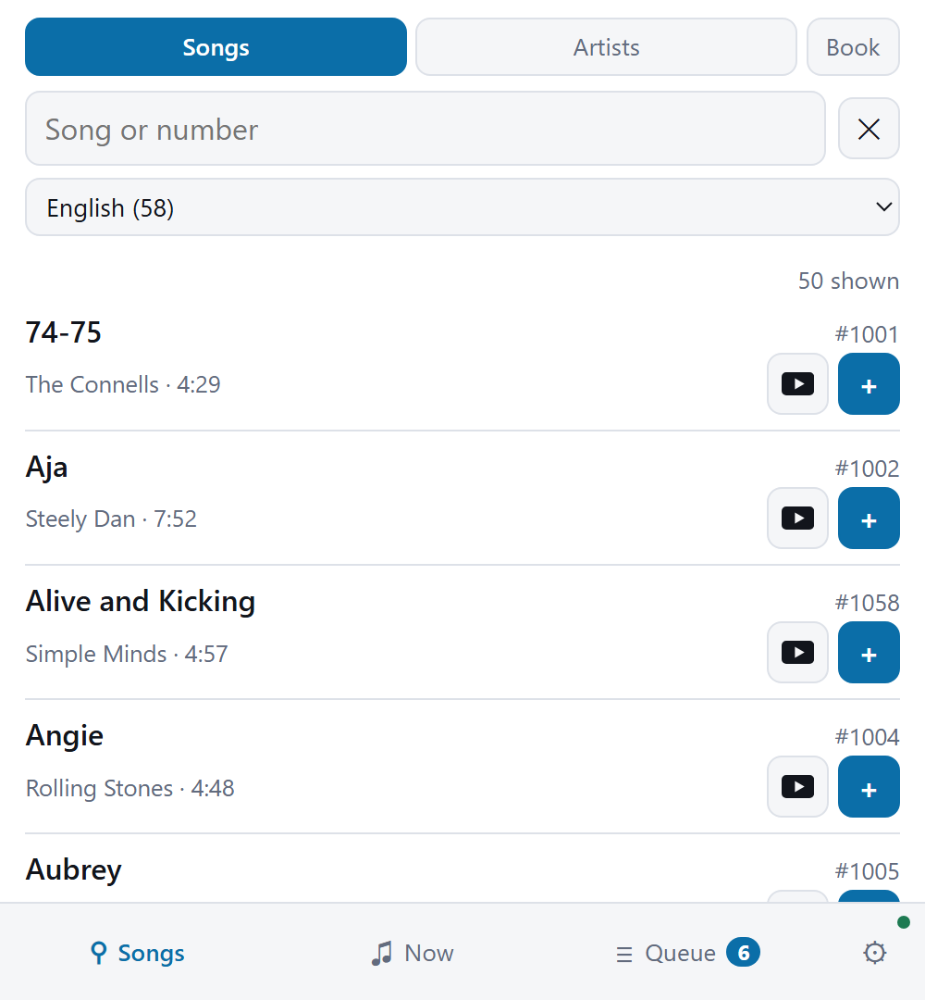
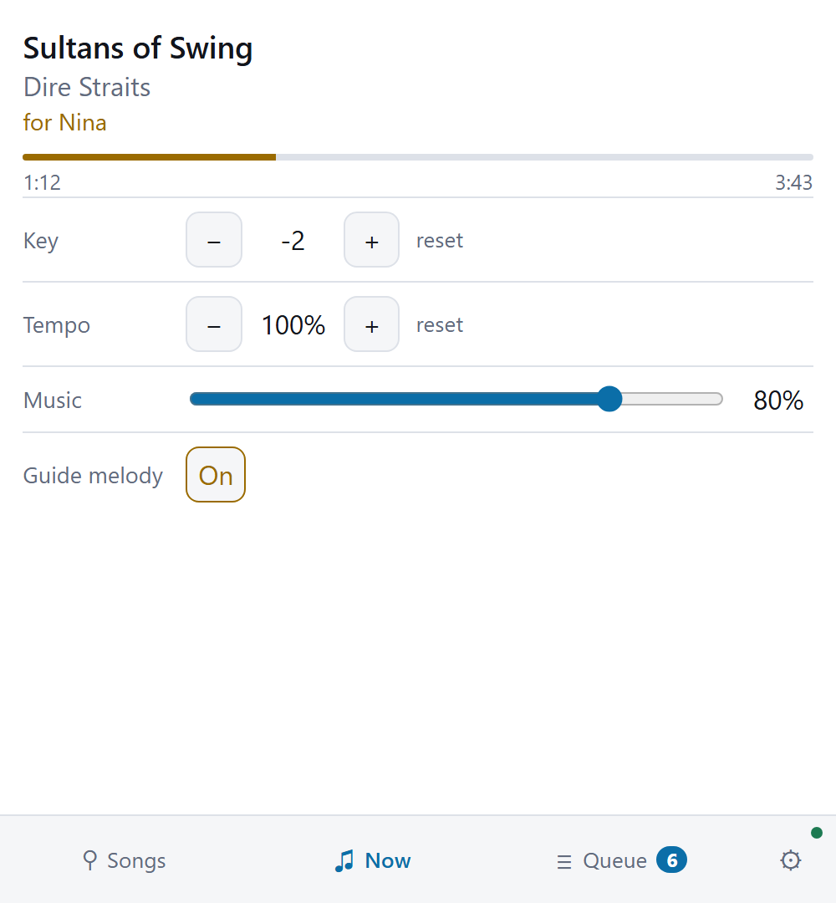
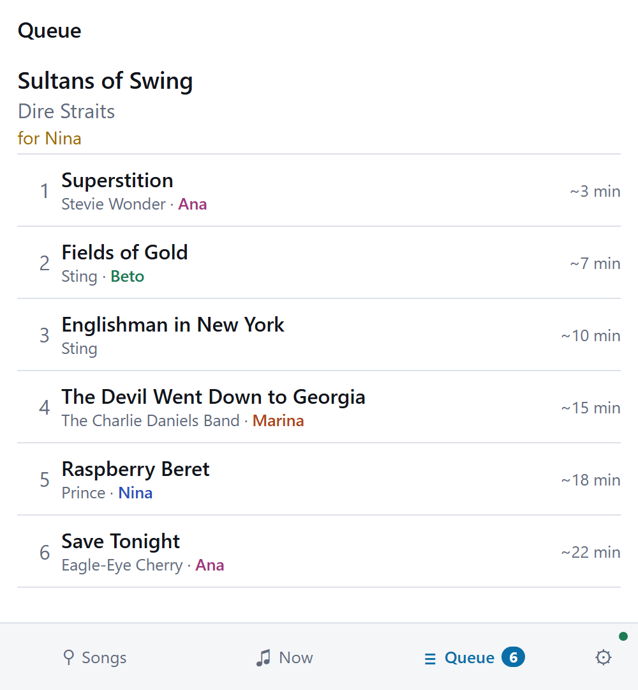
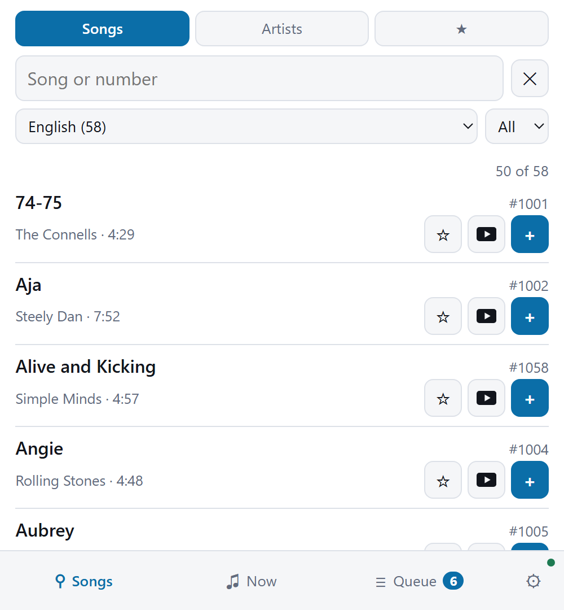

# The remotes

A phone is the machine's remote. A singer searches the catalog on it, queues a song, and sees what
plays. The machine has two remotes: a page it serves itself, and a separate program that works with
the machine switched off.

## The remote the machine serves

**The machine serves a remote at its own address**, and any phone on the network opens it. Nobody
installs an app.

**To open it, point a phone's camera at the QR code on the idle screen.** The screen also shows the
address, so nobody types an IP address. Mid-song, `I` shows the address and the code. `F11` opens the
same page in the browser of the computer the machine runs on. See [The keyboard](keyboard.md).

 <b>The idle screen.</b> Point a phone at the code, and the remote opens.

The remote has a page for each thing a singer does: find a song, follow the song that plays, and see
who is next.

<table>
<tr>
<td width="33%"></td>
<td width="33%"></td>
<td width="33%"></td>
</tr>
<tr>
<td><b>Search and queue</b> from any phone. No app to install.</td>
<td><b>The song as it plays</b>, with its key, tempo, guide melody and music volume.</td>
<td><b>Who is up next</b>, changeable by anyone with the skip level. The controls stay
folded until asked for.</td>
</tr>
</table>

**Each queued song shows about how long until it starts.** The Queue tab says `~4 min` or `< 1 min`
beside each song, and the figure counts down as the playing song runs. The
queue on the machine's screen shows the same figure.

**Singers take turns.** Tap **+** on as many songs as you like. The machine keeps one song for each
singer in the queue, and your next one goes in when yours starts. The Queue tab lists **Your
songs**, and says of each whether it is waiting, in the queue, or playing now. A song leaves the list when it
ends. Tap **✕** beside one to take it back. Below the queue, **Waiting for a turn** lists every
singer's waiting songs. Tap it to open the list.

**Your name is optional.** Type it in **Singing as** on the Setup tab, and the queue shows it.
Once it is saved, the box folds away, and **Change** opens it again. Two
singers cannot hold one name on the same evening. A phone that several people share adds each of
them under **Add another singer on this phone**, and then chooses who is singing. **Who is
singing** stands on the Setup tab and above the list on the Songs tab.

**A song somebody already has brings a question.** Tap **+** on a song that is in the queue, or
that somebody sang tonight, and the row says so. Tap **Ask anyway** to ask for it, or **✕** to
leave it.

**A phone with the skip code has a host's tab.** It is the ticked box in the tab bar. A host uses
it to run a night:

| The host wants to | On the host's tab |
|---|---|
| Add a song for a guest with no phone | Type the guest's name, search the song, and tap **+** |
| Add a song found on the Songs tab | Tap **👤** on the song, choose the singer, and tap **+** |
| Put a waiting song into the queue early | Tap **↑** for next, or **+** for the end of the queue |
| Refuse a waiting song | Tap **✕** beside it |
| Move a singer to another phone | Open the singer and tap **Hand to a phone**. The guest then types that name on the new phone |
| Join two names that are one person | Open one singer, choose the other, and tap **Merge into** |
| Take out a singer who went home | Open the singer and tap **Remove** |
| Stop taking songs near the end | Tap **Stop taking requests**. Songs already waiting still play |
| Clear everything for another night | Open **Start a new evening** and tap **Empty everything** |
| Go on after a restart, where the machine kept the night | Tap **Continue this evening** at the top |
| Clear a night that the machine kept | Tap **Start a new evening** at the top |

**A bar or a hall runs a night the same way.** [Running a public night](venue.md) has the
settings for one.

**The owner decides how much a guest's phone can do.** Out of the box, anybody in the room can ask
for a song. See [Setting it up from a browser](setup.md#decide-what-a-guests-phone-can-do).

**A phone running the machine shows this remote over its own screen.** Press **Menu** at the top of
the screen, then **Choose songs**. The song plays on behind it. Press **Close**, at the right, or
Back to return to the lyrics. A second app would take the screen away, and the machine pauses when that happens.

## The offline remote

**The offline remote is a separate program**, `km-remote`. It keeps its own copy of a machine's
catalog, so browsing, searching and favorites work **with the machine switched off**. You can choose
your songs before the machine is on.

It finds a machine on the network and remembers it. It also adds two things the served remote does
not have: favorites, and an A–Z picker.

 <b>The offline remote</b>, with its favorites mode and its A–Z picker.

It has its own download on every platform it runs on. See [Installing](installing.md).
