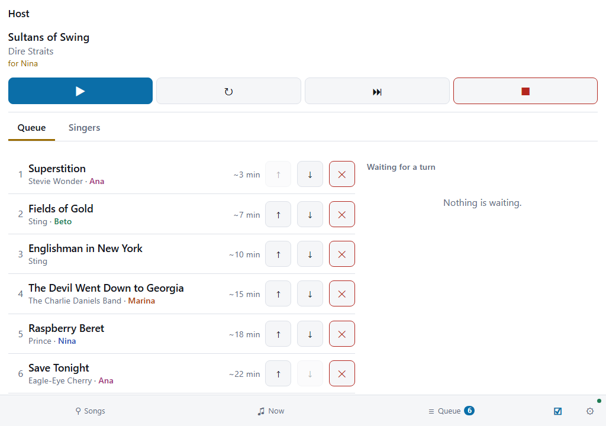

# Running a public night

A bar, a hall or a party of strangers runs on the same machine as a living room. Guests ask for
songs from their own phones, and the owner sets the singers to take turns. A host corrects what
the machine did.

**The night needs no second program and no account.** A guest installs nothing, and the machine
forgets the singers when the host starts a new evening.

**A venue's machine can keep the night through a power cut.** Turn on
*Keep the queue and the singers when the machine restarts*, and a restart loses nothing. See
[After a power cut or a restart](#after-a-power-cut-or-a-restart).

## Set the machine up once

**The owner sets eight things before the doors open.** All eight are on the setup pages' *This
machine* tab, under **Access** and **Singers and queue**. See
[Setting it up from a browser](setup.md#decide-what-a-guests-phone-can-do).

| Setting | At a venue | Why |
|---|---|---|
| The admin password | Set one of your own, and keep it | The machine shows its first password on its own screen, where every guest reads it |
| Room level | *Ask for songs* | Each table asks from a phone. The default lets every phone skip |
| Queue order | *Singers take turns* | Each singer gets a turn. The default plays songs in the order asked, so one table could fill the queue |
| Code for the host's tab | Set one, and give it to the host | It opens the host's tab |
| Code to skip | Set none | The host's code skips as well |
| Code to queue | Set none, or keep it | It adds a song out of turn, and it changes the key of any singer's song |
| Every singer gives a name | On | The host calls each singer by the name on the screen |
| Songs one singer may have waiting | A low number, such as 2 | One table cannot fill the list of waiting songs |
| Keep the queue and the singers when the machine restarts | On | A power cut does not end the night |

**Choose *Watch only* for the room where the host enters every song.** Guests then read the queue
on their phones and ask at the desk. The host adds each song on the host's tab.

**A host for one night needs the code for the host's tab and nothing else.** The admin password stays with the
owner, because a host changes no setting.

## Play a large collection from its own folder

**A venue's collection can stay in the folders it already has.** A normal package holds a copy of
every song file. For a collection of thousands of songs, that copy doubles the disk it takes. A
*linked package* holds no song file. It names each file by its path, and the machine plays the file
from where it is.

1. **Keep the collection in one folder on the machine's disk**, or on a drive the machine reaches.
2. **Build a linked package for each part of it.** Each packaging tool has a box for this. See
   [A package that holds no songs](packaging.md#a-package-that-holds-no-songs).
3. **Allow linked packages on the machine.** Name the folder and tick the box, both on the
   **Songs** tab. See [Linked packages](songs.md#linked-packages).
4. **Install each package** the way you install any other.

**Guests see no difference.** A linked package's songs are searched, numbered and queued like any
others.

**Do not move or rename the song files after you build the package.** A song whose file is missing
does not play, and the machine goes to the next song in the queue. A package whose whole folder is
missing does not install. The **Problems** tab names it, so check that tab before the doors open.

**A new song in the folder needs a new build of its package.** The machine plays only the files
the package names.

## What a guest does

1. **Open the remote.** Point a phone's camera at the QR code on the machine's idle screen.
2. **Type a name** in **Singing as** on the Setup tab.
3. **Tap + on a song.** Ask for as many as the machine allows.
4. **Read the Queue tab.** *Your songs* says of each song whether it waits, is in the queue, or
   plays now. A song leaves the list when it ends. A song in the queue shows about how long until
   it starts. Below the queue, **Waiting for a turn** lists every singer's waiting songs. Tap it
   to open the list.

**With turns on, the machine keeps one song for each singer in the queue.** A second song waits
until the first one starts, and then it goes to the end of the queue. So a table that asks for five
songs sings one, and then waits for every other singer's turn.

**No guest's phone changes another singer's song.** At this room level a phone cannot change the
key, the tempo or the volume, and it cannot skip.

## What the room sees

**The machine names each singer before the song.** For five seconds the whole screen shows the
title, the artist and the singer's name. Demo songs are not announced.

**While a song plays, the line under its title names the next song and its singer.** The singer's
name is blue, so the next singer finds it from across the room.

**The queue on the machine's screen shows a wait beside each song.** Press `Q` or `F6` on the
machine to show it, and the room sees who is near. Its top line also counts the songs that wait for
a turn. See [The keyboard](keyboard.md).

## What the host does

**The host types the code for the host's tab on the remote's Setup tab.** Tap **Enter a code**, type it, and
tap **Use**. The remote then shows the host's tab, which is the ticked box in the tab bar. The
controls stand at the top, and two tabs below them hold the queue and the singers.

**The host corrects, and the machine does the rest.** The host adds a song for a guest with no
phone, puts a waiting song in early, and refuses one. The host also moves a singer to another
phone, joins two names that are one person, and removes a singer who went home.
[The remotes](remotes.md#the-remote-the-machine-serves) lists each action and its button.

**Each singer's name has a colour of its own on every phone.** The host finds one singer's songs in
the queue at a glance. On the Songs tab, **👤** on a song takes it to the host's tab, ready to add
for a singer.

**The night runs with nobody at the desk.** A host who steps away loses only those corrections,
and the singers still take turns.

**Near the end, tap *Stop taking requests*.** Phones then read that the night is closed. The songs
that wait still play, and the host still adds one.

**For the next night, open *Start a new evening* and tap *Empty everything*.** That empties the
queue, the waiting songs and the singers. The machine does not restart.

## After a power cut or a restart

**With the setting on, the machine starts with the night it had.** The queue, the singers and the
waiting songs are all there. Each guest's phone still holds its singer, so nobody types a name
again. The song that was playing is first in the queue, and it starts from its beginning.

**The machine plays nothing until somebody chooses.** Its screen says that an earlier evening is
here, and how many songs and singers it holds. The host's tab says the same at its top. A guest
can still ask for a song, and that song waits with the others.

| To | At the machine | On the host's tab |
|---|---|---|
| Go on with the night | Press `Space` or `F1` | Tap **Continue this evening** |
| Clear a list from another day | Press `N` or `F4`, and press it again when the screen asks | Tap **Start a new evening** |

**The machine keeps a list until somebody clears it.** It does not clear a list because the list
is old. So the host of the next day clears it before the doors open.

**The machine loses one second of the night at most.** It also keeps a copy from about a minute
before. If a power cut damages the newest list, the machine starts with that copy.

**With the setting off, every start is an empty machine.** That suits a home.

## Two limits of the network

**Every phone must reach the machine over the venue's network.** Some guest networks keep each
phone apart from every other device. Such a network also keeps the phones from the machine, so turn
that setting off, or use another network.

**Anybody on that network can ask for a song.** No code raises one phone to asking alone. A venue
that wants only its own guests to ask keeps strangers off the network, or sets the room to
*Watch only*.

## What the machine leaves to the venue

**The machine knows nothing about the right to perform a song in public.** A venue arranges that
itself, as it does for any other music it plays.

**The machine does not rate a singer**, and it keeps no record of who sang after a new evening
starts. A new evening also removes the list that the machine kept for a restart.
